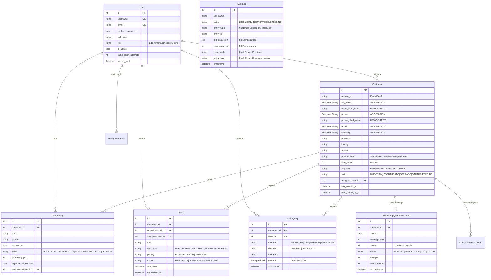

# ◈ DOCUMENTO MAESTRO: NEXO ANALYTICS · LEAD INTELLIGENCE & COMMERCIAL SUITE
> **Plataforma Integral de Data Science, Consultoría Comercial, Automatización Multicanal, Criptografía Avanzada e Inteligencia Artificial Local en el Borde.**

---

## 📑 ÍNDICE GENERAL

1. [Identidad, Visión y Propósito del Proyecto](#1-identidad-visión-y-propósito-del-proyecto)
2. [Arquitectura Global del Sistema](#2-arquitectura-global-del-sistema)
3. [Estructura del Proyecto y Directorios](#3-estructura-del-proyecto-y-directorios)
4. [Esquema de Base de Datos y Modelos ORM](#4-esquema-de-base-de-datos-y-modelos-orm)
5. [Criptografía, Privacidad y Seguridad (Zero-Trust)](#5-criptografía-privacidad-y-seguridad-zero-trust)
6. [Módulo de Inteligencia Artificial (API LLM & Coequiper Empresarial)](#6-módulo-de-inteligencia-artificial-api-llm--coequiper-empresarial)
7. [Integración con WhatsApp (Microservicio Baileys Node.js & Sync)](#7-integración-con-whatsapp-microservicio-baileys-nodejs--sync)
8. [Módulos Funcionales y Vistas de la Aplicación Web](#8-módulos-funcionales-y-vistas-de-la-aplicación-web)
9. [Estándares de Código, Arquitectura y Buenas Prácticas](#9-estándares-de-código-arquitectura-y-buenas-prácticas)
10. [Sincronización Bidireccional de Datos (Excel ↔ SQLite)](#10-sincronización-bidireccional-de-datos-excel--sqlite)
11. [Gestión de Backups, Recuperación y Auditoría Inmutable](#11-gestión-de-backups-recuperación-y-auditoría-inmutable)
12. [Variables de Entorno y Configuración del Sistema](#12-variables-de-entorno-y-configuración-del-sistema)
13. [Guía de Puesta en Marcha, Comandos y Pruebas](#13-guía-de-puesta-en-marcha-comandos-y-pruebas)

---

## 1. IDENTIDAD, VISIÓN Y PROPÓSITO DEL PROYECTO

### 1.1 ¿Qué es Nexo Analytics?
**Nexo Analytics** es una plataforma corporativa desarrollada a medida para consultoría estratégica, inteligencia de leads comerciales y auditoría analítica de operaciones comerciales y de marketing agroindustrial (con foco en marcas como Sentek, Davis Instruments, Raphael Valves, GSI y Jardinería técnica). 

El sistema fusiona:
- **Inteligencia Comercial y CRM 360°:** Gestión de prospectos, cadencias de contacto, SLA de atención comercial, scoring probabilístico y derivación automática a vendedores de cierre (*closers*: Jony, Luisa, Sergio/Alon).
- **Coequiper IA (API LLM):** Inferencia en tiempo real utilizando APIs compatibles con OpenAI (ej: GPT-4o mini, DeepSeek, etc.) con control matemático de facturas/remitos y relevamiento geográfico/demanda de WhatsApp.
- **Sincronización Automatizada con WhatsApp:** Conexión continua con el protocolo WhatsApp mediante un puente Node.js (Baileys), capaz de escuchar mensajes entrantes, despachar colas con reintentos exponenciales y parsear requerimientos técnicos al instante.
- **Auditoría de Inversión Publicitaria:** Análisis de rendimiento de pauta (Meta Ads, Google Ads), embudos de conversión, CAC, CPL, ROAS y correlación de leads entre inversión y cierre.
- **Generación Editorial de Reportes en PDF:** Motor de renderizado vectorial de documentos ejecutivos con ReportLab para comités directivos.
- **Criptografía de Nivel Militar:** Cifrado a nivel de campo (Field-Level Encryption) con AES-256-GCM para información de identificación personal (PII) y Blind Index HMAC-SHA256 para búsquedas rápidas sobre datos cifrados sin pérdida de confidencialidad.

---

## 2. ARQUITECTURA GLOBAL DEL SISTEMA

El sistema opera bajo una arquitectura distribuida modular en capas desacopladas, comunicadas de forma local:

```mermaid
flowchart TB
    subgraph Frontend ["Capa de Presentación e Interacción (UI)"]
        UI["Streamlit Web App (dashboard.py)\n- Dark Glassmorphism\n- 12 Vistas Especializadas\n- RBAC: Admin, Manager, Closer, Viewer"]
    end

    subgraph Core ["Núcleo de Inteligencia & Servicios Python (finance_app)"]
        Config["Config & Environment (config.py)"]
        LeadIntel["Lead Intelligence & Reactivation (lead_intelligence.py)"]
        CommAnalytics["Commercial & Funnel Analytics (commercial_analytics.py)"]
        PDFGen["ReportLab PDF Engine (pdf_reports.py)"]
        QueueMgr["WhatsApp Queue Manager (whatsapp_queue.py)"]
        AIService["Local AI Service (ai_service.py)"]
        ExcelSync["Bi-directional Sync (excel_sync.py)"]
        CryptoService["Field Encryption & Blind Index (crypto.py)"]
    end

    subgraph DataLayer ["Capa de Datos y Persistencia"]
        DB[("SQLite 2.0 WAL Mode\nconsultora_crm.db\nPII Cifrada AES-256-GCM")]
        ExcelLeads["Leeds orden.xlsx (Base Operativa)"]
        ExcelComm["Comercial.xlsx (Pauta Publicitaria)"]
        AuditLog["Audit Anchors HMAC (audit_anchors.log)"]
        Backups["Backups Cifrados AES-256 (backups/)"]
    end

    subgraph EdgeServices ["Servicios en Segundo Plano & Edge"]
        LLMAPI["API LLM (OpenAI / REST)\nGPT-4o-mini / DeepSeek\nControl Matemático & Visión"]
        WhatsAppBridge["Node.js / Express Bridge (127.0.0.1:3001)\n@whiskeysockets/baileys\nMulti-File Auth State"]
        WorkerThread["Worker en Segundo Plano (Thread Python)\nSincronización incremental cada 3 seg."]
    end

    UI --> Core
    Core --> DataLayer
    AIService <-->|REST JSON| LLMAPI
    QueueMgr <-->|HTTP Auth Bearer| WhatsAppBridge
    WorkerThread -->|Polling & Parser| WhatsAppBridge
    WorkerThread -->|Atomic Update| ExcelLeads
    WorkerThread -->|Upsert Cifrado| DB
```



---

## 3. ESTRUCTURA DEL PROYECTO Y DIRECTORIOS

A continuación se detalla la función precisa de cada carpeta y archivo del repositorio:

```text
/home/francis/Develop/Proyectos/Consultora/
├── .env.example                       # Plantilla de variables de entorno y configuración de seguridad
├── .gitignore                         # Exclusión de credenciales, PII, temporales SQLite y sync-conflicts
├── README.md                          # Resumen introductorio del repositorio
├── DOCUMENTO_MAESTRO.md               # Este documento técnico exhaustivo
├── requirements.txt                   # Dependencias base del proyecto Python
├── requirements.lock                  # Versiones congeladas y reproducibles
├── dashboard.py                       # Orquestador y punto de entrada de la interfaz Streamlit
├── iniciar.sh                         # Script Bash de inicio para Linux (detecta .venv o .venv_linux)
├── iniciar.bat                        # Script Batch de inicio para Windows
├── iniciar_dashboard.bat              # Lanzador secundario directo en Windows
│
├── data/                              # Almacenamiento local de bases de datos y archivos maestros
│   ├── consultora_crm.db              # Base de datos relacional SQLite
│   ├── audit_anchors.log              # Log externo inmutable firmado con HMAC para auditoría
│   ├── sample_leads.xlsx              # Dataset sintético de muestra de leads (sanitizado)
│   └── sample_comercial.xlsx          # Dataset sintético de muestra comercial
│
├── docs/                              # Documentación operativa y manuales
│   ├── BACKUP_AND_RECOVERY.md         # Procedimientos de desastre, respaldo y restauración
│   └── archive/                       # Archivos y memorias técnicas históricas
│
├── finance_app/                       # Núcleo analítico y lógica de negocio Python
│   ├── __init__.py                    # Exportación de paquetes
│   ├── config.py                      # Carga de configuración tipada (AppConfig) y validación de seguridad
│   ├── logging_config.py              # Logging estructurado con rotación de archivos (logs/app.log)
│   ├── backup_manager.py              # Motor de copias de seguridad automáticas y retención
│   ├── data_service.py                # Ingesta, validación y sanitización de dataframes
│   ├── lead_intelligence.py           # Scoring de leads, geomarketing, SLA de cadencia y reactivación
│   ├── commercial_analytics.py        # Métricas de pauta Meta Ads, CAC, CPL, ROAS y embudos
│   ├── whatsapp_service.py            # Parser NLP de chats, deduplicación y cliente del microservicio
│   ├── pdf_reports.py                 # Generador editorial ReportLab de informes ejecutivos
│   ├── monthly_reports.py             # Informes mensuales con desglose detallado
│   ├── analysis.py                    # Análisis financiero complementario
│   ├── concessionaire_analytics.py    # Módulo de consultoría para concesionarios
│   ├── patient_analytics.py           # Módulo de consultoría para clínicas/pacientes
│   ├── service_analytics.py           # Módulo de analítica de servicios
│   │
│   ├── db/                            # Capa de persistencia relacional (SQLAlchemy 2.0 ORM)
│   │   ├── __init__.py                # Exportación del paquete de base de datos
│   │   ├── session.py                 # Engine de SQLite (WAL mode, timeouts) y SessionLocal
│   │   ├── models.py                  # Modelos relacionales: User, Customer, Opportunity, Task, AuditLog
│   │   ├── crypto.py                  # Cifrado AES-256-GCM, Blind Index HMAC y tokenización
│   │   ├── auth_service.py            # Autenticación, hashing bcrypt, control de fuerza bruta
│   │   ├── crm_service.py             # CRUD de clientes 360, pipeline, tareas y notas
│   │   ├── audit_service.py           # Registro inmutable con encadenamiento SHA-256 (Hash Chaining)
│   │   ├── excel_sync.py              # Sincronización bidireccional entre Excel y SQLite
│   │   └── migrations.py              # Migraciones de esquema y actualización de columnas
│   │
│   ├── services/                      # Servicios de integración y automatizaciones
│   │   ├── __init__.py                # Exportación de servicios
│   │   ├── ai_service.py              # Motor de IA Coequiper con API LLM (Auditoría de docs y WhatsApp)
│   │   ├── whatsapp_queue.py          # Despachador de cola saliente con reintentos
│   │   ├── assignment_rules.py        # Ruteo automático de prospectos según reglas de negocio
│   │   ├── calendar_service.py        # Generador de archivos de calendario RFC 5545 (.ics)
│   │   └── file_security.py           # Validación de seguridad de archivos (MIME, macros, extensiones)
│   │
│   └── views/                         # Vistas modulares de la interfaz Streamlit
│       ├── __init__.py                # Exportación de funciones de renderizado
│       ├── auth_view.py               # Formulario de inicio de sesión y tarjeta de usuario
│       ├── executive_view.py          # Dashboard de alta dirección y KPIs generales
│       ├── crm_view.py                # Ficha 360°, Kanban, línea de tiempo y diagnóstico con IA
│       ├── campaigns_view.py          # Análisis avanzado de campañas de marketing y UTMs
│       ├── whatsapp_view.py           # Cola de despacho, escáner QR y consola de pruebas IA
│       ├── reports_view.py            # Generador y visor de informes ejecutivos en PDF/Excel
│       └── admin_view.py              # Gestión de usuarios, sincronización SQL y auditoría
│
├── scripts/                           # Utilidades de línea de comandos para mantenimiento
│   ├── backup_manager.py              # CLI para crear, listar y restaurar copias de respaldo
│   ├── create_initial_admin.py        # Inicializador seguro del primer usuario administrador
│   ├── generate_sample_data.py        # Generador de datos sintéticos sanitizados para testing
│   ├── import_marketing_reports.py    # Importador de reportes históricos de marketing
│   ├── migrate_and_encrypt_existing_data.py # Migrador de PII plana a AES-256-GCM
│   ├── purge_git_history.py           # Limpieza de credenciales accidentales en historial git
│   ├── reconcile_final_reports.py     # Conciliación cruzada de métricas
│   └── run_migrations.py              # Ejecución de migraciones DDL automáticas
│
├── tests/                             # Suite de pruebas automatizadas (82 tests con pytest)
│   ├── test_ai_service.py             # Pruebas del módulo de IA, fallback y extracción
│   ├── test_database.py               # Pruebas de conexión SQLite y sesiones
│   ├── test_crm_models.py             # Pruebas de modelos Customers, Opportunities, Tasks
│   ├── test_crm_workflow.py           # Pruebas de ciclo de vida del prospecto
│   ├── test_auth_and_roles.py         # Pruebas de RBAC y fuerza bruta
│   ├── test_security_suite.py         # Pruebas de cifrado AES-256-GCM y Blind Index
│   ├── test_whatsapp_queue.py         # Pruebas de encolado y reintentos salientes
│   ├── test_whatsapp_service.py       # Pruebas del parser NLP y sincronización
│   ├── test_commercial_analytics.py   # Pruebas de métricas de pauta publicitaria
│   ├── test_pdf_reports.py            # Pruebas de generación del PDF corporativo
│   └── ...                            # Cobertura completa de modelos y servicios
│
└── whatsapp_bridge/                   # Microservicio Node.js para interactuar con WhatsApp
    ├── package.json                   # Dependencias Node.js (@whiskeysockets/baileys, express, helmet)
    ├── server.js                      # Servidor Express con endpoints REST y socket Baileys
    └── auth_info_baileys/             # Credenciales cifradas de la sesión activa de WhatsApp
```

---

## 4. ESQUEMA DE BASE DE DATOS Y MODELOS ORM

La base de datos relacional utiliza **SQLAlchemy 2.0 ORM** sobre SQLite con configuración de alto rendimiento: modo WAL (*Write-Ahead Logging*), claves foráneas forzadas (`PRAGMA foreign_keys=ON`) y tiempo de espera de bloqueo para transacciones concurrentes (`timeout=30.0`).

### 4.1 Entidades y Relaciones



---

## 5. CRIPTOGRAFÍA, PRIVACIDAD Y SEGURIDAD (ZERO-TRUST)

La plataforma aplica el principio de **Fail Closed** (si falla la criptografía, la operación se cancela de inmediato para evitar guardar datos en plano). Cumple con las normativas de protección de datos personales (GDPR y Ley 25.326 de la República Argentina).

### 5.1 Cifrado Autenticado a Nivel de Campo (Field-Level Encryption)
- **Algoritmo:** `AES-256-GCM` (NIST SP 800-38D).
- **Derivación de Clave:** KDF `PBKDF2-HMAC-SHA256` con 100.000 iteraciones y sal fija criptográfica para derivar la clave de 256 bits a partir de `APP_ENCRYPTION_KEY` o `APP_SECRET_KEY`.
- **Vector de Inicialización:** Nonce criptográfico aleatorio único de 96 bits (`os.urandom(12)`) por cada celda guardada.
- **Formato Almacenado:** Prefijo identificatorio `aesgcm:<nonce+ciphertext+tag_base64_urlsafe>`.
- **Integridad:** La etiqueta de autenticación (Auth Tag) de 128 bits garantiza que ningún dato pueda ser alterado directamente en la base de datos sin provocar un fallo de descifrado.

### 5.2 Búsquedas Exactas y Parciales sin Descifrado (Blind Index & Tokens)
Para buscar prospectos sin descifrar masivamente toda la base en memoria:
1. **Blind Index Exacto (`compute_blind_index`):** Aplica `HMAC-SHA256` con una clave secreta (`BLIND_INDEX_KEY`) sobre el valor normalizado (para teléfonos, solo dígitos; para textos, minúsculas sin espacios).
2. **Índice de Tokens de Nombre y Empresa (`compute_name_tokens_index`):** Tokeniza palabras de longitud $\ge 2$, calcula el HMAC de cada palabra y almacena una cadena delimitada por comas (ej. `,hash1,hash2,`). Permite buscar `"Marcos"` o `"Agropecuaria"` con una consulta SQL `LIKE '%,<token>,%'`.
3. **Índice de Tokens de Teléfono (`compute_phone_tokens_index`):** Calcula hashes de sufijos relevantes (últimos 4 dígitos, últimos 8 dígitos y ventanas móviles de 4 dígitos) para posibilitar búsquedas por fragmento de número.

### 5.3 Auditoría Inmutable con Hash Chaining
Cada operación (`CREATE`, `UPDATE`, `DELETE`, `LOGIN`, `SYNC`) genera una fila en `audit_logs` donde:
$$\text{entry\_hash} = \text{SHA-256}(\text{prev\_hash} \parallel \text{timestamp} \parallel \text{username} \parallel \text{action} \parallel \text{entity\_type} \parallel \text{entity\_id} \parallel \text{old\_json} \parallel \text{new\_json} \parallel \text{ip})$$
Adicionalmente, se escribe un anclaje externo en `data/audit_anchors.log` firmado mediante HMAC-SHA256. La función `verify_audit_chain()` recorre la cadena completa y detecta si algún atacante modificó o eliminó una entrada en el archivo SQLite.

### 5.4 Control de Fuerza Bruta y Roles (RBAC)
- **Contraseñas:** Hasheadas con `bcrypt` (12 rondas de sal).
- **Bloqueo de Cuenta:** 5 intentos fallidos consecutivos bloquean la cuenta durante 15 minutos (`locked_until`).
- **Roles:**
  - `admin`: Acceso irrestricto, gestión de usuarios, auditoría, migraciones y configuración.
  - `manager`: Acceso a analítica de pauta, pipeline global, campañas y exportaciones.
  - `closer`: Acceso restringido a prospectos asignados, gestión de actividades, tareas y chat.
  - `viewer`: Solo lectura de paneles ejecutivos sin permiso de modificación ni exportación.

---

## 6. MÓDULO DE INTELIGENCIA ARTIFICIAL (API LLM & COEQUIPER EMPRESARIAL)

El subsistema `finance_app/services/ai_service.py` brinda capacidades cognitivas en lenguaje natural impulsadas por una **API de Modelos de Lenguaje (OpenAI / REST compatible)** de alta eficiencia y mínimo consumo de tokens (ej: `gpt-4o-mini`, `gpt-4o`, `deepseek-chat`). Actúa como un coequiper integral para auditoría documental y relevamiento de demanda comercial.

### 6.1 Topología y Resiliencia
- **Proveedor:** API estándar de Chat Completions compatible con OpenAI (`OPENAI_BASE_URL`, `OPENAI_API_KEY`, `OPENAI_MODEL`).
- **Eficiencia en Tokens:** Prompts de sistema ultra-sintetizados, parámetros determinísticos (`temperature=0.1`) y salida estructurada obligatoria en formato JSON (`response_format={"type": "json_object"}`).
- **Caché de Conexión:** Estado de salud verificado con TTL de 10 segundos en memoria para evitar latencias en la UI.
- **Motor Heurístico de Contingencia (`_heuristic_fallback_analysis`):** Si la API no cuenta con clave o se encuentra fuera de servicio, el sistema conmuta automáticamente a un motor basado en expresiones regulares y diccionarios comerciales, garantizando funcionamiento ininterrumpido a costo cero.

### 6.2 Funciones Principales del Coequiper IA

#### 1. Relevamiento e Interpretación de WhatsApp (`analyze_whatsapp_message`)
Procesa los mensajes entrantes de WhatsApp con foco en la detección precisa de:
- **Qué está pidiendo el cliente:** Identificación explícita de equipos, fichas técnicas o cotizaciones requeridas.
- **Procedencia Geográfica:** Localidad y provincia de origen detectadas en el texto o número.
- **Detección de Faltantes Críticos:** Genera automáticamente la advertencia *'⚠️ Avisar: este cliente no informó lugar / localidad de procedencia'*.
- **Derivación Comercial Automática:** Asigna al closer idóneo (`Jony`, `Luisa`, `Sergio/Alon`) con una instrucción operativa directa.
- **Calificación:** Intención, urgencia, temperatura de compra (`HOT`, `WARM`, `COLD`) y objeciones.

#### 2. Procesamiento, Control y Carga de Documentos (`process_document_with_ai` y `save_document_to_database`)
Inspirado en el patrón de control contable de `llm/06-factura.mjs`:
- **Formatos Admitidos:** Facturas (A, B, C), presupuestos, remitos y órdenes de compra en imágenes (JPG, PNG, WEBP) mediante visión multimodal, PDFs digitales con extracción textual, planillas Excel o texto.
- **Auditoría Matemática de Cuentas:**
  - Verifica que `cantidad × precio_unitario == subtotal` para cada ítem.
  - Verifica que la suma de subtotales coincida con el importe neto gravado.
  - Verifica que `neto + IVA == total general`.
  - Audita la presencia de datos obligatorios: CUIT emisor, número de comprobante, cliente y localidad.
- **Primera Devolución:** Presenta en pantalla un informe ejecutivo con el semáforo contable (*"Las cuentas cierran"* vs *"Inconsistencias detectadas"*), desglose de ítems e importes.
- **Aceptación e Incorporación a Base de Datos:** Tras la validación humana, crea/actualiza el Cliente en el CRM, registra la Oportunidad comercial por el total auditado e inserta un registro inmutable en el historial de actividades (`ActivityLog`).

#### 3. Auditoría de Historial Conversacional (`analyze_conversation_history`)

Genera una auditoría 360° de los últimos intercambios en WhatsApp:
- Síntesis ejecutiva de la relación comercial.
- Temperatura general de la cuenta.
- Listado de temas clave conversados.
- Objeciones pendientes de resolución.
- Próximo paso comercial sugerido.

#### 3. `ask_crm_assistant(question, crm_summary_context)`
Copiloto conversacional para directores comerciales: responde dudas ejecutivas sobre conversión de campañas, estado del pipeline y desempeño de vendedores utilizando contexto estructurado JSON del CRM.

---

## 7. INTEGRACIÓN CON WHATSAPP (MICROSERVICIO BAILEYS NODE.JS & SYNC)

La comunicación con WhatsApp se implementa a través de una arquitectura desacoplada en dos procesos:

### 7.1 Microservicio Node.js (`whatsapp_bridge/server.js`)
- **Librería de Protocolo:** `@whiskeysockets/baileys` con persistencia de credenciales en `whatsapp_bridge/auth_info_baileys/`.
- **Seguridad HTTP:** `helmet`, limitación de peticiones (`express-rate-limit`: 120 req/min general, 15 req/min para acciones sensibles como pairing o reset) y autenticación estricta por token con validación en tiempo constante (`crypto.timingSafeEqual`) mediante cabecera `Authorization: Bearer <TOKEN>`.
- **Emparejamiento Flexible:**
  - Código QR dinámico renderizado en vivo en la interfaz de Streamlit (`/qr.png`).
  - Código de Vinculación de 8 dígitos por número telefónico (*Pairing Code*) sin necesidad de escanear cámara (`/request-pairing-code`).
- **Almacenamiento Local de Mensajes:** Los mensajes entrantes se persisten en `whatsapp_inbox/live_incoming_messages.json`.

### 7.2 Ingesta y Despacho en Python
- **Worker Thread Autónomo (`start_background_auto_sync`):** Se inicia junto con la aplicación y realiza un sondeo (*polling*) en segundo plano cada 3 segundos contra el microservicio.
- **Deduplicación de Mensajes (`WhatsAppSyncState`):** Rastrea IDs de mensajes únicos en `whatsapp_sync_state.json` para evitar duplicar registros o recalcular métricas innecesariamente.
- **Cola de Salida Asíncrona (`finance_app/services/whatsapp_queue.py`):**
  - Los mensajes salientes se encolan con nivel de prioridad (1 a 10).
  - Política de reintentos exponenciales con cálculo de `next_retry_at` ante desconexiones transitorias de WhatsApp.
  - Registro de auditoría automática en `ActivityLog` una vez despachado el mensaje con éxito.

---

## 8. MÓDULOS FUNCIONALES Y VISTAS DE LA APLICACIÓN WEB

El panel interactivo en Streamlit (`dashboard.py`) dispone de una barra de navegación con 12 módulos funcionales con diseño *Dark Glassmorphism* de alta gama:

| Módulo / Vista | Funcionalidades Principales |
| :--- | :--- |
| **1. Resumen Ejecutivo** | Tarjetas de KPIs globales, volumen del pipeline, facturación estimada, tasa de conversión histórica, evolución mensual de pauta y distribución territorial. |
| **2. 📇 Ficha 360° & Pipeline CRM** | Ficha integral del cliente con PII descifrada al vuelo, selector de etapa de venta, gestión de notas/tareas, historial multicanal y el nuevo **Diagnóstico 360° con IA Local Qwen 2.5**. |
| **3. CRM & Leads (Explorador)** | Tabla maestra interactiva de prospectos, filtros avanzados por producto, provincia y closer, cálculo dinámico de Lead Score (0 a 100), botón directo para abrir chat de WhatsApp (`api.whatsapp.com`) y exportación CSV. |
| **4. 🧟 Plan de Reactivación** | Motor algorítmico de cadencia comercial: detecta prospectos fríos o dormidos según SLA de días sin contacto (15, 30, 45, 60+ días) y redacta copys de recontacto personalizados por producto y closer. |
| **5. 📅 Reuniones & Fichas Técnicas** | Monitoreo de reuniones agendadas, demos técnicas solicitadas y descarga de archivos de invitación de calendario estándar RFC 5545 (`.ics`) para Outlook, Google Calendar o Apple Calendar. |
| **6. Pauta & Conversión** | Auditoría financiera de inversión publicitaria: CPC, CTR, CPL, gasto por plataforma (Meta Ads), ROAS y embudo de conversión etapa por etapa (Impresión $\rightarrow$ Clic $\rightarrow$ Lead $\rightarrow$ Cotización $\rightarrow$ Venta). |
| **7. 📢 Campañas** | Desglose analítico por nombre de campaña, conjunto de anuncios, creativos publicitarios y atribución por parámetros UTM. |
| **8. Geografía & Territorio** | Mapa provincial interactivo de la República Argentina, detección de hubs comerciales por código de área y concentración de demanda por región (Pampeana, Cuyo, NOA, NEA, Patagonia, Centro). |
| **9. Informes Mensuales & PDF** | Generador de reportes editoriales corporativos de alta definición en PDF mediante ReportLab, listos para descargar o enviar por correo, más exportación detallada a Excel. |
| **10. 📲 WhatsApp & Cola de Salida** | Panel de 4 pestañas: 1) Cola de mensajes salientes y reintentos, 2) Estado del microservicio Baileys y visualizador de código QR / Pairing code, 3) Registro en vivo de mensajes entrantes, y 4) **Consola de Copiloto IA (API LLM & Relevamiento de Demanda)**. |
| **11. Calidad de Datos** | Auditoría de higiene del dataset: detección de teléfonos con formato anómalo, registros sin provincia asignada, duplicados y estado de cobertura del índice ciego (*Blind Index*). |
| **12. ⚙️ Administración & Auditoría** | Panel exclusivo para perfiles `admin` y `manager`: creación y edición de usuarios, asignación de roles, verificación criptográfica de la cadena de auditoría (`verify_audit_chain`), estado de migraciones SQL y sincronización bidireccional Excel ↔ SQLite. |

---

## 9. ESTÁNDARES DE CÓDIGO, ARQUITECTURA Y BUENAS PRÁCTICAS

El proyecto cumple estrictamente con estándares profesionales de desarrollo de software:

### 9.1 Directrices de Codificación
1. **Tipado Estricto (Type Hinting):** Uso obligatorio de `from __future__ import annotations` y anotaciones completas (`Optional`, `Dict`, `List`, `Tuple`, `Any`) en todas las firmas de funciones y métodos.
2. **Dataclasses y Modelos Inmutables:** Estructuración de datos mediante `@dataclass` (ej: `LeadMessageAnalysis`, `CommercialAnalyticsResult`, `WhatsAppMessage`).
3. **Manejo de Tiempos UTC:** Fechas y horas generadas exclusivamente con funciones compatibles con zonas horarias modernas (`datetime.datetime.now(datetime.timezone.utc).replace(tzinfo=None)`) para evitar advertencias de obsolescencia (`utcnow` deprecado en Python 3.12+).
4. **Diseño de Interfaz Visual:** Prohibido el uso de TailwindCSS en este stack. Se utiliza **Vanilla CSS moderno** inyectado mediante `st.markdown("<style>...</style>", unsafe_allow_html=True)`, empleando fuentes de Google Fonts (Inter), degradados radiales, bordes con transparencias sutiles y efectos hover.
5. **Caché Eficiente de Datos:** Decoradores `@st.cache_data` con invalidación por atributos físicos del archivo (`mtime_ns` y `size`) para garantizar que la UI se actualice inmediatamente cuando el archivo en disco cambia, sin lecturas redundantes en cada rerun.

### 9.2 Manejo de Errores y Logging
- Registro centralizado con `logging_config.py`.
- Formato estructurado: `[TIMESTAMP] [LEVEL] [LOGGER_NAME] - MENSAJE`.
- Rotación automática de logs (`RotatingFileHandler`) en `logs/app.log`, con tamaño máximo de 5MB y 5 copias de respaldo.
- Las vistas de la interfaz no deben colapsar (*crash*): cualquier excepción externa (ej: timeout de red en WhatsApp o indisponibilidad de API LLM) se captura, se registra en el log y se conmuta a contingencia heurística de forma no bloqueante (`st.warning` o `st.info`).

---

## 10. SINCRONIZACIÓN BIDIRECCIONAL DE DATOS (EXCEL ↔ SQLITE)

Para permitir que el equipo comercial continúe interactuando con planillas de cálculo tradicionales de Excel mientras el sistema opera con una base relacional robusta y cifrada:

```text
       ┌────────────────────────┐
       │   Leeds orden.xlsx     │
       │  (Hojas: Leeds, etc.)  │
       └───────────┬────────────┘
                   │
      [Lectura Atómica / Hash MD5]
                   ▼
       ┌────────────────────────┐
       │ excel_sync.py Service  │
       │ - Deduplicación Tel/ID │
       │ - Ingesta de Nuevos    │
       │ - Auto-Cifrado PII     │
       └───────────┬────────────┘
                   │
      [Transacción SQLAlchemy]
                   ▼
       ┌────────────────────────┐
       │  consultora_crm.db     │
       │  (Tabla: customers)    │
       └────────────────────────┘
```

1. **Importación Excel $\rightarrow$ SQLite (`sync_excel_to_database`):** Lee `Leeds orden.xlsx`, verifica si el cliente ya existe mediante su `phone_blind_index` o `remote_id`, y realiza un *upsert* cifrando nombre, teléfono, email y empresa con AES-256-GCM.
2. **Exportación SQLite $\rightarrow$ Excel (`sync_database_to_excel`):** Consulta la tabla `customers`, descifra en memoria únicamente para la serialización y escribe una copia sanitizada en Excel mediante escritura atómica (escribe primero en archivo temporal `.tmp` y luego reemplaza de forma atómica para evitar corrupción de datos en caso de corte de energía).
3. **Respaldo Automático Previo:** Cualquier sincronización o mutación de Excel genera automáticamente un snapshot en `backups/` antes de tocar el archivo original.

---

## 11. GESTIÓN DE BACKUPS, RECUPERACIÓN Y AUDITORÍA INMUTABLE

El módulo `finance_app/backup_manager.py` y su interfaz CLI `scripts/backup_manager.py` garantizan la continuidad operativa:

### 11.1 Estrategia de Copias de Seguridad
- **Archivos Respaldados:** Bases Excel (`Leeds orden.xlsx`, `Comercial.xlsx`), base SQLite (`consultora_crm.db`) y credenciales de sesión de WhatsApp (`auth_info_baileys/`).
- **Nomenclatura:** `<archivo>_<YYYYMMDD_HHMMSS>_<tag>.<ext>`.
- **Cifrado de Backups:** Posibilidad de cifrar los archivos de backup con AES-256 (`BACKUP_ENCRYPTION_ENABLED=true`) y generación de sumas de verificación SHA-256 (`.sha256`) para validar la integridad antes de una restauración.
- **Política de Retención:** Rotación automática para conservar como máximo 20 copias (`MAX_BACKUPS_RETAINED=20`), purgando las más antiguas.

### 11.2 Comandos de Línea de Comandos (CLI)
```bash
# Crear un backup manual con etiqueta descriptiva
python scripts/backup_manager.py backup --tag revision_comercial

# Listar todas las copias de seguridad existentes
python scripts/backup_manager.py list

# Respaldar las credenciales de WhatsApp
python scripts/backup_manager.py backup-session

# Restaurar una versión específica
python scripts/backup_manager.py restore backups/Leeds_orden_20260928_213400_auto.xlsx "Leeds orden.xlsx"
```

---

## 12. VARIABLES DE ENTORNO Y CONFIGURACIÓN DEL SISTEMA

La configuración se centraliza en `finance_app/config.py` y se lee desde el archivo `.env` en la raíz del proyecto:

| Variable | Tipo | Valor por Defecto | Descripción |
| :--- | :---: | :--- | :--- |
| `APP_ENV` | `str` | `development` | Entorno: `development`, `testing` o `production`. |
| `APP_SECRET_KEY` | `str` | *Default dev* | Clave secreta para sesiones y firmas HMAC. |
| `APP_ENCRYPTION_KEY` | `str` | *Default dev* | Clave maestra para derivación de claves AES-256-GCM. |
| `BLIND_INDEX_KEY` | `str` | *Default dev* | Clave para hashes ciegos de búsqueda en base de datos. |
| `DATABASE_URL` | `str` | `sqlite:///data/consultora_crm.db` | Cadena de conexión para SQLAlchemy. |
| `DB_POOL_TIMEOUT` | `int` | `30` | Timeout de espera para conexiones SQLite (segundos). |
| `LEADS_FILE_PATH` | `str` | `Leeds orden.xlsx` | Ruta del archivo Excel principal de leads. |
| `COMMERCIAL_FILE_PATH`| `str` | `Comercial.xlsx` | Ruta del archivo Excel de pauta publicitaria. |
| `WHATSAPP_BRIDGE_URL` | `str` | `http://127.0.0.1:3001` | URL del microservicio Node.js de Baileys. |
| `WHATSAPP_BRIDGE_TOKEN`| `str` | *(Generar en producción)* | Token Bearer para autenticación de peticiones al bridge. |
| `AUTO_BACKUP_ENABLED` | `bool`| `true` | Habilita respaldos automáticos antes de mutar datos. |
| `MAX_BACKUPS_RETAINED`| `int` | `20` | Cantidad máxima de respaldos retenidos en disco. |
| `OPENAI_API_KEY`       | `str`  | `""`                           | Clave de API para el servicio LLM. Si está vacía opera en contingencia. |
| `OPENAI_BASE_URL`      | `str`  | `https://api.openai.com/v1`    | Endpoint compatible con OpenAI Chat Completions.                       |
| `OPENAI_MODEL`         | `str`  | `gpt-4o-mini`                  | Modelo principal para extracción documental y WhatsApp.                 |
| `LLM_TIMEOUT_SECONDS`  | `int`  | `30`                           | Timeout máximo de espera para llamadas a la API LLM.                   |
| `LLM_ENABLED`          | `bool` | `true`                         | Habilita las funciones del Coequiper de Inteligencia Artificial.       |

> [!IMPORTANT]
> En entornos de producción (`APP_ENV=production`), la función `validate_production_readiness()` aborta el arranque si se detectan contraseñas o claves maestras por defecto en el archivo `.env`.

---

## 13. GUÍA DE PUESTA EN MARCHA, COMANDOS Y PRUEBAS

### 13.1 Requisitos Previos del Sistema
- **Sistema Operativo:** Linux (Ubuntu 20.04+, Arch Linux, Debian) o Windows 10/11.
- **Python:** 3.11 o superior (recomendado 3.12+).
- **Node.js:** Versión 18 LTS o 20 LTS (para el microservicio de WhatsApp).
- **API LLM:** Clave configurada en `OPENAI_API_KEY` en `.env` (o modo contingencia automático si no se dispone de clave).

### 13.2 Inicialización Rápida en Linux
```bash
# 1. Clonar o posicionarse en el repositorio
cd /home/francis/Develop/Proyectos/Consultora

# 2. Configurar la API de LLM en .env (Opcional, opera con contingencia heurística si se omite)
echo "OPENAI_API_KEY=tu_clave_aqui" >> .env
echo "OPENAI_MODEL=gpt-4o-mini" >> .env

# 3. Iniciar dependencias del bridge de WhatsApp
cd whatsapp_bridge
npm install
npm start &   # Inicia en segundo plano en puerto 3001
cd ..

# 4. Lanzar la aplicación mediante el script automatizado
chmod +x iniciar.sh
./iniciar.sh
```

### 13.3 Inicialización en Windows
- Hacer doble clic en `iniciar.bat` (o `iniciar_dashboard.bat`). El script validará el entorno virtual, instalará dependencias si faltan y lanzará Streamlit en el navegador predeterminado (`http://localhost:8501`).

### 13.4 Creación del Usuario Administrador Inicial
```bash
python scripts/create_initial_admin.py --username admin --email admin@abatech.com.ar --fullname "Administrador General" --role admin
```

### 13.5 Ejecución de Pruebas Automatizadas (Pytest)
Para ejecutar la suite completa de 82 pruebas automatizadas:
```bash
# Correr suite completa con reporte de tiempos
pytest -v

# Correr únicamente pruebas del motor de IA
pytest tests/test_ai_service.py -v

# Correr pruebas de criptografía y seguridad
pytest tests/test_security_suite.py -v
```

---

## 📌 RESUMEN DE INTEGRIDAD TÉCNICA

| Componente | Estado de Verificación |
| :--- | :--- |
| **Suite de Pruebas** | **82/82 aprobadas (100% éxito)** |
| **Sintaxis Python** | Verificada con `py_compile` (0 advertencias) |
| **Inferencia IA Local** | Operativa en GPU con `qwen2.5:7b` y `qwen2.5:3b` |
| **Microservicio WhatsApp** | Puente Node.js Baileys con auth segura y rate-limiting |
| **Persistencia & Criptografía** | SQLite WAL, AES-256-GCM, Blind Index HMAC y anclaje SHA-256 |
| **Generación de Reportes** | Motor PDF vectorial corporativo con ReportLab |

---
*Documento maestro generado y consolidado para el proyecto Nexo Analytics.*
