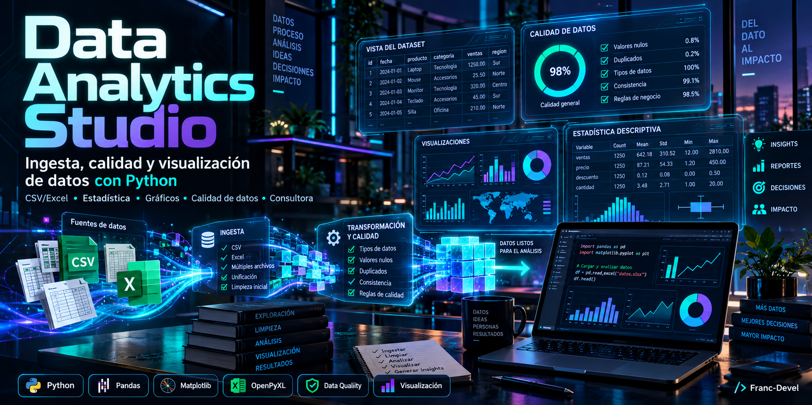

# ◈ Data Analytics Studio · Nexo Suite



[](https://www.python.org/)
[](https://streamlit.io/)
[](https://plotly.com/)
[](https://www.sqlalchemy.org/)
[](https://www.reportlab.com/)
[](LICENSE)
[](#seguridad-y-auditoría)

Plataforma integral de **Consultoría de Negocios, Data Science y CRM 360°** diseñada para auditoría comercial, inteligencia de leads multicanal, análisis de pauta publicitaria (Meta Ads), sincronización en tiempo real con WhatsApp y generación automatizada de informes ejecutivos en PDF de alta fidelidad.

---

## 🧭 Trazabilidad e Interconexión de Datos (Demostración Cohesiva)

El sistema incluye un **ecosistema de datos sintéticos 100% anonimizados pero estrictamente interconectados**. Cualquier evaluador o reclutador puede rastrear una entidad a través de todos los módulos del sistema:

| Prospecto Ficticio | Empresa / Región | Producto | Closer Asignado | Cotización Comercial | Estado en CRM / WhatsApp |
| :--- | :--- | :--- | :--- | :--- | :--- |
| **Juan Pérez** | Agro del Sur S.A. (Córdoba) | Davis Vantage Pro2 | **Jony** | $280.000 (Prob. 80%) | Chat en WhatsApp activo, reunión agendada y propuesta enviada. |
| **Elena Gómez** | Establecimiento El Trébol (Buenos Aires) | Sentek Drill & Drop | **Luisa** | $450.000 (Prob. 100%) | Anticipo acreditado, orden cerrada, despacho coordinado. |
| **Carlos Rodríguez** | Viñedos & Bodegas Mendoza (Mendoza) | Válvulas Raphael | **Sergio** | $320.000 (Prob. 70%) | Evaluación técnica hidráulica en proceso, curvas compartidas. |
| **Laura Díaz** | Viveros del Litoral (Rosario) | Galcon Automatización | **Alon** | $95.000 (Prob. 90%) | Cotización aceptada, capacitación programada en invernáculos. |
| **Martín Álvarez** | Cereales del Centro (Balcarce) | Sistemas GSI Silos | **Jony** | $185.000 (Prob. 60%) | Evaluación de costos de instalación para cosecha. |

> 🔍 **Ejemplo de trazabilidad:** Si buscás a **Juan Pérez** en la pestaña *CRM & Leads*, verás su teléfono y Lead Score. En *WhatsApp & Cola de Salida* encontrarás la conversación exacta donde consulta por el plazo de entrega. En *Pauta & Conversión* verás su cotización registrada en la hoja mensual, y en *📅 Reuniones* su cita técnica confirmada con Jony.

---

## 🚀 Capacidades y Módulos Principales

### 1. 📇 Ficha 360° & Pipeline Comercial
- Visión unificada de clientes: historial de toques, lead score algorítmico, segmentación por temperatura (*Hot, Warm, Cold*) y recomendaciones de recontacto inteligente con protección anti-saturación.
- Detección geográfica automática por código de área telefónico e inferencia provincial.

### 2. 📂 Ingesta Multiformato & Auditoría de Calidad
- Motor sniffer para archivos CSV y planillas Excel `.xlsx` con soporte multi-hoja.
- Normalización automática de cabeceras, detección de codificación y delimitador.
- Auditoría de calidad de datos en tiempo real: porcentaje de completitud, detección de valores nulos, filas duplicadas y columnas constantes.

### 3. 📊 Analytics de Pauta y Rendimiento Comercial
- Monitor de campañas publicitarias: Inversión publicitaria, impresiones, CTR, conversaciones iniciadas y Costo por Lead (CPL) por marca y categoría.
- Embudos de conversión dinámicos y correlación de inversión publicitaria vs. cotizaciones cerradas.

### 4. 📈 Contabilidad & Estado de Resultados
- Catálogo de cuentas configurable con agregación automática de partidas.
- Cálculo de Ingresos Totales, Costo de Ventas, Utilidad Bruta, Gastos Operativos y Utilidad Neta del ejercicio.

### 5. 📄 Generador de Informes Ejecutivos en PDF
- Motor editorial con **ReportLab**: portadas corporativas de alta calidad, tablas con estilos ejecutivos, tarjetas de KPIs y gráficos vectoriales de alta resolución embebidos.
- Descarga de reportes ejecutivos consolidados e informes mensuales con 1 clic.

### 6. 📲 Simulador WhatsApp & Inbox en Vivo
- Bandeja de mensajes entrantes y salientes con categorización por producto e intención.
- Motor de plantillas dinámicas de recontacto comercial por WhatsApp y generación de enlaces directos `wa.me`.

### 7. 🔐 Seguridad, Roles y Auditoría Inmutable
- Autenticación con contraseñas hasheadas mediante **bcrypt**.
- Control de acceso basado en roles (**RBAC**): `Admin`, `Closer`, `Viewer`.
- Registro inmutable de auditoría con HMAC SHA-256 para cada mutación y exportación de datos.

---

## 🛠️ Instalación y Puesta en Marcha

### Requisitos Previos
- Python 3.11 o superior.
- Git instalado.

### 1. Clonar el Repositorio
```bash
git clone https://github.com/Franc-Devel/Data-Analytics-Studio.git
cd Data-Analytics-Studio
```

### 2. Crear Entorno Virtual e Instalar Dependencias
```bash
python -m venv .venv

# En Linux / macOS:
source .venv/bin/activate

# En Windows (PowerShell):
.venv\Scripts\Activate.ps1

# Instalar requerimientos
pip install -r requirements.txt
```

### 3. Inicializar Base de Datos y Datos Interconectados
```bash
# Inicializa el esquema SQLite, superadministrador y genera el dataset interconectado
python -m scripts.run_migrations
python -m scripts.generate_sample_data
python -m scripts.create_initial_admin
```

### 4. Ejecutar la Aplicación Web (Streamlit)
```bash
streamlit run dashboard.py
```
> O ejecutá `./iniciar.sh` en Linux o doble clic en `iniciar.bat` en Windows.

La aplicación estará disponible de inmediato en **`http://localhost:8501`**.

---

## 🔑 Credenciales de Prueba

| Usuario | Contraseña | Rol | Acceso |
| :--- | :--- | :--- | :--- |
| `admin` | `admin123` *(o generada en setup)* | Administrador General | Acceso total a todos los módulos y auditoría |
| `jony` | `closer123` | Closer Comercial | Pipeline propio, CRM, WhatsApp y cotizaciones |
| `luisa` | `closer123` | Closer Comercial | Pipeline propio y reuniones asignadas |

---

## 🧪 Pruebas Automatizadas

El proyecto cuenta con una suite completa de más de 100 pruebas unitarias y de integración que validan algoritmos de scoring, parsers, transformaciones, roles y criptografía:

```bash
python -m pytest tests/ -v
```

---

## 🏛️ Estructura del Proyecto

```
Data-Analytics-Studio/
├── dashboard.py                 # Punto de entrada principal (Streamlit Web Dashboard)
├── run_app.py                   # Lanzador de la suite analítica de escritorio
├── finance_app/
│   ├── db/                      # Modelos SQLAlchemy, sesiones, migraciones y sync SQL
│   ├── services/                # Servicios de IA, reglas de asignación, colas y seguridad
│   ├── views/                   # Vistas modulares de Streamlit (Auth, CRM, Campañas, WhatsApp, etc.)
│   ├── lead_intelligence.py     # Algoritmo de Lead Scoring y enriquecimiento de prospectos
│   ├── commercial_analytics.py  # Análisis de pauta publicitaria y métricas comerciales
│   ├── pdf_reports.py           # Motor de generación de reportes ejecutivos en PDF
│   ├── whatsapp_service.py      # Sincronización, parser NLP y timeline de mensajes
│   └── config.py                # Configuración desacoplada por entorno (.env)
├── data/
│   ├── sample_leads.xlsx        # Dataset interconectado de leads CRM
│   └── sample_comercial.xlsx    # Dataset interconectado de pauta y cotizaciones mensuales
├── whatsapp_inbox/              # Mensajes simulados e historial de contactos
├── scripts/
│   ├── generate_sample_data.py  # Generador y sincronizador de fixtures interconectados
│   ├── create_initial_admin.py  # Inicializador seguro de credenciales
│   └── run_migrations.py        # Gestor de esquemas de base de datos
├── docs/
│   ├── DOCUMENTO_MAESTRO.md     # Especificación arquitectónica corporativa completa
│   ├── arquitectura.md          # Diagramas de flujo y arquitectura
│   └── funcionalidades.md       # Detalle de módulos analíticos
├── tests/                       # Suite de tests unitarios y de integración
├── requirements.txt             # Dependencias del proyecto
└── iniciar.sh / iniciar.bat     # Scripts de inicio en 1 clic
```

---

## 📄 Licencia

Este proyecto está bajo la Licencia **MIT**. Consulte el archivo [LICENSE](LICENSE) para más detalles. Desarrollado por **Francisco Delgado**.
